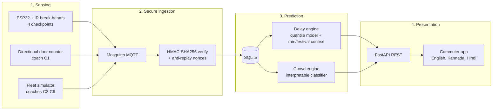

<div align="center">


**A model train with real sensors, a secure IoT pipeline and ML models that answer the two questions every Bengaluru commuter asks: *"How late is it?"* and *"Which coach should I board?"***


</div>

> **Repo name:** `NammaPrayana` ("our journey" in Kannada). **Project name:** NammaFlow.

---

## 🚇 Results at a glance

<div align="center">

| | Metric | Result | Target |
|:-:|---|:-:|:-:|
| 👥 | **Best-coach crowd classification** vs hand counts | **93.86 %** | ≥ 80 % |
| 📉 | Station-average baseline (for comparison) | 77.19 % | – |
| ⚡ | **Sensor → app latency (p99)** | **0.197 s** | < 3 s |
| 🔐 | Forged / replayed messages accepted | **0** | 0 |

<sub>Crowd model evaluated on 19 held-out sessions (split by session, no leakage). Details in <a href="docs/MODEL_CARD.md">docs/MODEL_CARD.md</a>.</sub>

</div>

## 🧩 How it works



## ✨ What makes it interesting

**1 · Hardware in the loop, not just a notebook**
A physical model train runs past ESP32 infrared break-beam gates at four checkpoints (*Start → Mid → Majestic → End*). A two-sensor **directional door counter** (a small state machine in [`hardware/occupancytrial1.ino`](hardware/occupancytrial1.ino)) counts passengers in and out of coach C1.

**2 · Source-swap architecture**
The *same* pipeline accepts live hardware messages **or** recorded files without code changes (`scripts/run_source_swap.py`). Models can be built without the train, and recorded runs can be replayed.

**3 · Security as a feature**
Every sensor message is signed with **HMAC-SHA256** over a *canonical* JSON form, checked in constant time, and protected by a **sliding nonce window** against replay. Fake or replayed "delay" messages are rejected. See [`docs/THREAT_MODEL.md`](docs/THREAT_MODEL.md).

**4 · Context-aware delay forecasting**
A quantile model trained on simulator laps predicts the delay at **Majestic interchange** as a *range* (e.g. "2 to 6 min"), tagged with a **probable contributing factor** (rain or festival from the calendar and saved weather data).

**5 · Interpretable crowd guidance**
A multi-threshold decision model classifies each coach as **Low / Medium / High** using people count, time of day, rush hour, coach position, stair distance and capacity ratio, then recommends the emptiest coach.

**6 · Honest claims**
This is a testbed. We **don't** claim to predict live Namma Metro trains, rain and festivals are only *probable* factors, and coaches C2–C6 are simulated. Being clear about limits is part of the work.

## 🚀 Quickstart

```bash
git clone https://github.com/Stanvi09/NammaPrayana.git
cd NammaPrayana
python -m pip install -r requirements.txt
cp .env.example .env                 # Windows: copy .env.example .env
python scripts/start_demo.py         # or start_demo.bat / ./start_demo.sh
```

Open **http://localhost:8000/docs** for the interactive API.
*(Mosquitto is optional. Without a broker the backend runs in fallback mode.)*

| Task | Command |
|---|---|
| Run all tests | `python -m pytest tests -v` |
| Simulate coaches C2–C6 | `python simulator/fleet_simulator.py --seed 42 --steps 10 --dry-run` |
| Replay recorded data through the pipeline | `python scripts/run_source_swap.py` |
| Benchmark latency | `python scripts/benchmark_latency.py` |
| Generate device keys | `python scripts/generate_keys.py` |
| Commuter app | `cd Frontend && npm install && npx expo start` |

## 📁 Repository map

```
NammaPrayana/
├── backend/app/
│   ├── api/           # /health /train /delay /crowd /context /security
│   ├── services/      # pipeline, delay engine, crowd engine, source-swap, watchdog
│   ├── crowd/         # crowd model + training
│   ├── mqtt/          # client, topics, handlers
│   ├── security/      # HMAC, canonical serialisation, replay protection
│   └── schemas/       # Pydantic models
├── simulator/         # deterministic fleet simulator (C2–C6)
├── schemas/           # frozen JSON Schemas for train & door messages
├── nammaflow-A/       # delay-model research: data, training, CV results
├── nammaflow-A-for-D/ # packaged simulator-trained delay model used by the backend
├── Frontend/          # Expo / React Native commuter app (EN · KN · HI, read-aloud)
├── hardware/          # ESP32 firmware: station timing + door occupancy counter
├── tests/             # pytest suite: e2e, security, schemas, performance, source-swap
├── scripts/           # demo, benchmark, key generation, probes
├── docs/              # architecture, API, data format, model card, runbook, threat model
└── paper/             # IEEE-format paper draft (LaTeX + BibTeX)
```

## 📄 Documentation & paper

[Architecture](docs/ARCHITECTURE.md) · [API](docs/API.md) · [Data format](docs/DATA_FORMAT.md) · [Model card](docs/MODEL_CARD.md) · [Security](docs/SECURITY.md) · [Threat model](docs/THREAT_MODEL.md) · [Runbook](docs/RUNBOOK.md) · [Paper draft](paper/paper_draft.md)

## 👥 Team

Built by a four-person team, each owning one layer: sensing hardware, delay modelling, the commuter app, and backend / security / crowd modelling.

---

<div align="center">

**Tanvi Sadashiv**
<br/>
<a href="https://www.linkedin.com/in/tanvi-sadashiv-3713ba381"></a>
<a href="https://github.com/Stanvi09"></a>


</div>
