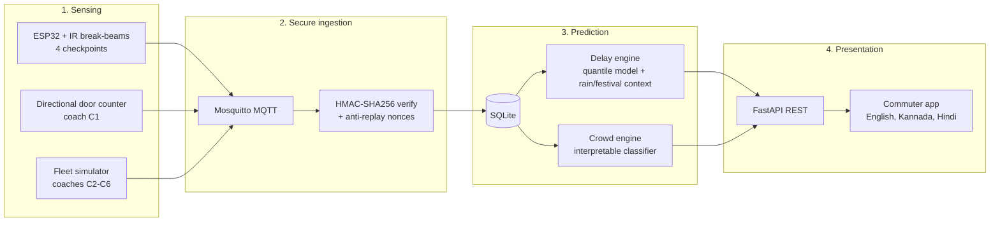
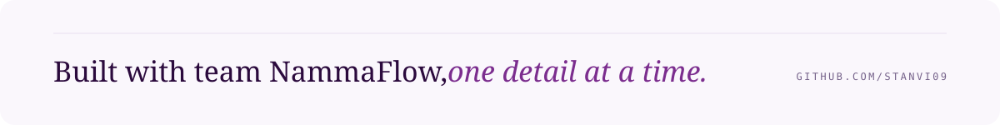

<picture>
  <source media="(prefers-color-scheme: dark)" srcset=".github/assets/header-dark.svg">
  
</picture>

<p align="center"><sub>Repository <b>NammaPrayana</b>, "our journey" in Kannada &nbsp;&middot;&nbsp; Project <b>NammaFlow</b></sub></p>

<picture>
  <source media="(prefers-color-scheme: dark)" srcset=".github/assets/stats-dark.svg">
  
</picture>

<br>

## 01 &nbsp; The question

Every Bengaluru commuter on a platform asks the same two things: **how late is it, and which coach should I get into?**
NammaFlow answers both on a model train fitted with real sensors, and is honest about where the testbed ends.

## 02 &nbsp; How it works



| Layer | What happens |
|---|---|
| **Sensing** | A model train passes ESP32 infrared break-beam gates at *Start, Mid, Majestic* and *End*. A two-beam state machine on coach C1 tells boarding from alighting. Coaches C2 to C6 come from a seeded simulator. |
| **Secure ingestion** | Every message is signed with HMAC-SHA256 over a canonical JSON form, checked in constant time, and has to pass a sliding nonce window, so replayed or forged delays are rejected. |
| **Prediction** | A quantile model gives the delay at Majestic interchange as a **range**, tagged with a *probable* factor (rain or festival). An interpretable classifier rates each coach Low, Medium or High and picks the emptiest. |
| **Presentation** | FastAPI with interactive docs, and an Expo app in three languages that can read advice aloud. |

## 03 &nbsp; Decisions I'd defend in an interview

- **Source-swap architecture.** The same pipeline takes live hardware messages or recorded files with no code changes. The models could be built without the train, and any run can be replayed exactly.
- **Ranges, not single numbers.** "Two to six minutes" is honest, and "four minutes" is false precision.
- **An interpretable crowd model.** Thresholds on people count, rush hour, coach position, stair distance and capacity. When it says *board coach 4*, you can explain why.
- **The split is by session.** 56 training and 19 test sessions, with no coach from a test session ever seen in training. That's why 93.86% is a number worth trusting.

## 04 &nbsp; Honest claims

This is a testbed. We **don't** claim to predict live Namma Metro trains. Rain and festivals are only *probable contributing factors*, and coaches C2 to C6 are simulated. Being clear about limits is part of the work.

## 05 &nbsp; Run it

```bash
git clone https://github.com/Stanvi09/NammaPrayana.git && cd NammaPrayana
python -m pip install -r requirements.txt
cp .env.example .env
python scripts/start_demo.py          # or start_demo.bat / ./start_demo.sh
```

Open **http://localhost:8000/docs**. Mosquitto is optional, and the backend falls back cleanly without a broker.

| Task | Command |
|---|---|
| Tests | `python -m pytest tests -v` |
| Simulate coaches C2 to C6 | `python simulator/fleet_simulator.py --seed 42 --steps 10 --dry-run` |
| Replay recorded data | `python scripts/run_source_swap.py` |
| Benchmark latency | `python scripts/benchmark_latency.py` |
| Commuter app | `cd Frontend && npm install && npx expo start` |

## 06 &nbsp; Repository map

```
NammaPrayana/
├── backend/app/
│   ├── api/            /health /train /delay /crowd /context /security
│   ├── services/       pipeline, delay and crowd engines, source-swap, watchdog
│   ├── crowd/          crowd model and training
│   ├── mqtt/           client, topics, handlers
│   ├── security/       HMAC, canonical serialisation, replay protection
│   └── schemas/        Pydantic models
├── hardware/           ESP32 firmware: station timing and door counter
├── simulator/          deterministic fleet simulator
├── schemas/            frozen JSON Schemas for train and door messages
├── nammaflow-A/        delay-model research: data, training, CV results
├── nammaflow-A-for-D/  packaged delay model used by the backend
├── Frontend/           Expo commuter app
├── tests/              e2e, security, schemas, performance, source-swap
├── scripts/            demo, benchmark, key generation
├── docs/               architecture, API, data format, model card, threat model
└── paper/              IEEE-format paper draft
```

## 07 &nbsp; Read more

[Architecture](docs/ARCHITECTURE.md) &nbsp;&middot;&nbsp; [API](docs/API.md) &nbsp;&middot;&nbsp; [Model card](docs/MODEL_CARD.md) &nbsp;&middot;&nbsp; [Security](docs/SECURITY.md) &nbsp;&middot;&nbsp; [Threat model](docs/THREAT_MODEL.md) &nbsp;&middot;&nbsp; [Runbook](docs/RUNBOOK.md) &nbsp;&middot;&nbsp; [Paper draft](paper/paper_draft.md)

## 08 &nbsp; Team

Built by a four-person team, each owning one layer: sensing hardware, delay modelling, the commuter app, and backend, security and crowd modelling.

<br>

<picture>
  <source media="(prefers-color-scheme: dark)" srcset=".github/assets/footer-dark.svg">
  
</picture>

<p align="center"><sub><a href="https://www.linkedin.com/in/tanvi-sadashiv-3713ba381">LinkedIn</a> &nbsp;&middot;&nbsp; <a href="https://github.com/Stanvi09">GitHub</a></sub></p>
