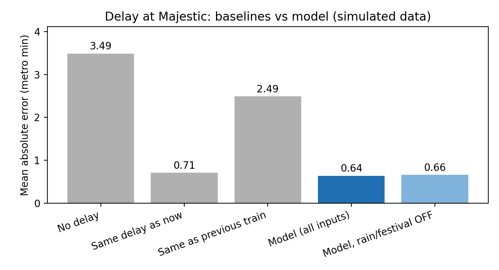

# Partial results: delay at Majestic

Data: `data/dummy_laps.csv` (316 laps, 32 sessions, split by session).

|                          |   Mean error (min) |   Within 1 min (%) |
|:-------------------------|-------------------:|-------------------:|
| No delay                 |               3.49 |              35.44 |
| Same delay as now        |               0.71 |              85.76 |
| Same as previous train   |               2.49 |              43.67 |
| Model (all inputs)       |               0.64 |              91.46 |
| Model, rain/festival OFF |               0.66 |              90.51 |

## Interpretation

The model beats the strongest baseline (same delay as now): its mean error is 0.64 min against 0.71 min, a 10% reduction, and 91% of predictions fall within 1 minute (baseline 86%). Switching the rain and festival flags off raises the error from 0.64 to 0.66 min, so these context inputs help. These numbers come from SIMULATED data, so they show that the pipeline works, not that the method works on a real metro. They must be re-run on the real testbed laps. Every result uses cross-validation split by whole session, and the locked test sessions were not used.
